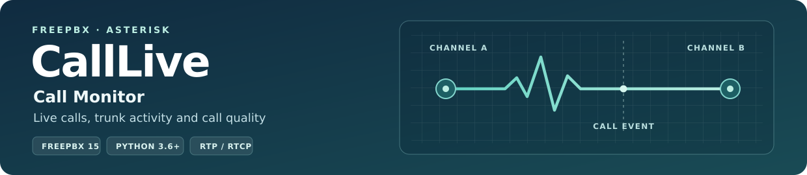
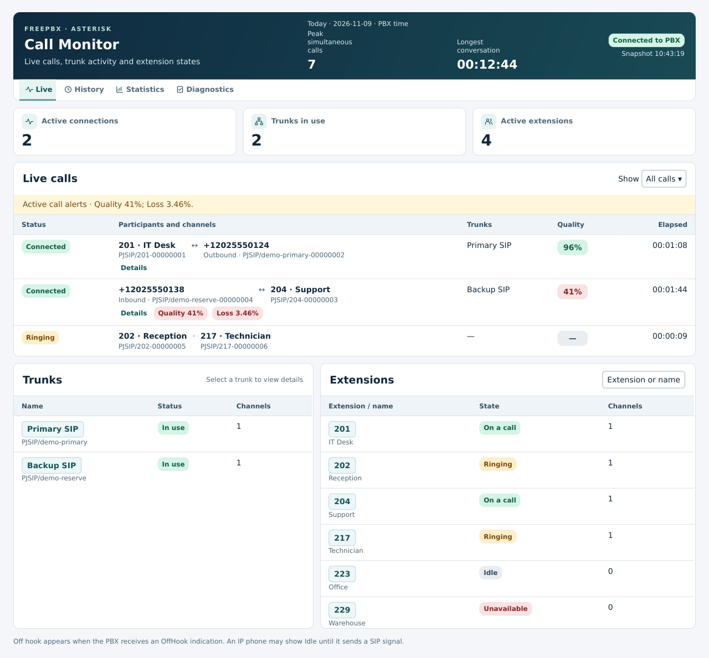
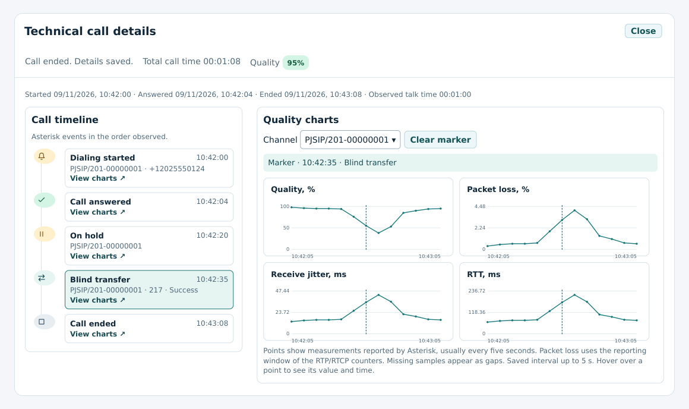
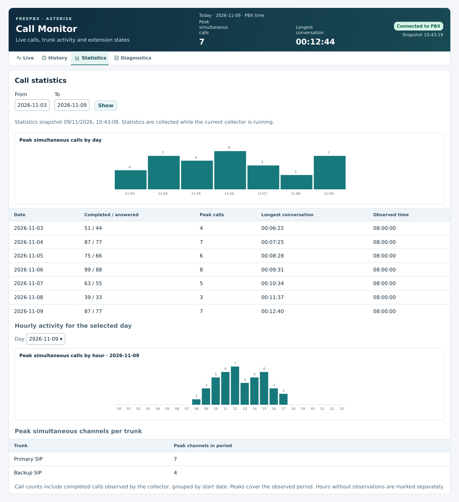
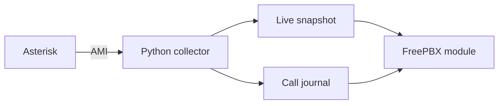

# CallLive for FreePBX 15



**CallLive** shows live calls, trunk usage, extension states and RTP/RTCP quality in **Reports → Call Monitor**. This English edition is based on the [original CallLive 15.0.9 source](https://github.com/shayena84-byte/freepbx-calllive/tree/d88cd4dcce059bd2ff822fdcb73fd33c9db0c271).

[Russian version](https://github.com/shayena84-byte/freepbx-calllive) · **English version**

[Features](#features) · [Screens](#screens) · [Installation](#installation) · [Operations](#operations) · [Architecture](#architecture)

**[Installation package 15.0.10](dist/15.0.10)** · **FreePBX 15 / Core** · **Tested with Asterisk 16** · **Linux / systemd / Python 3.6+**

## Features

| Section | What it shows |
| --- | --- |
| **Live** | Call participants, channels, trunks, extension states and live quality. The header shows the daily peak, longest conversation and PBX connection status. |
| **History** | Observed, completed calls, searchable by date, number or channel. Open saved details or filter for poor quality. |
| **Technical call details** | Dialing, answer, hold, transfer and hangup events reported by Asterisk. Select a timeline event to mark its timestamp across the quality, loss, jitter and RTT charts. |
| **Statistics** | Daily and hourly peaks, completed and answered calls, longest conversations and peak channels per trunk. |
| **Diagnostics** | Module and collector compatibility, AMI status, snapshot age and history storage. Full administrators can adjust alert thresholds and copy the collector setup command. |

Select a trunk or extension for its details. Depending on the PBX configuration, extensions can show DND, forwarding, Follow Me, devices and registration. Persistent quality, packet loss and wait conditions trigger alerts in the open dashboard.

## Screens

These examples use demonstration data rendered from the module.

### Live dashboard



### Call timeline and quality

Select an event to mark its time on all four charts. If measurements exist for its channel, CallLive selects that channel. The dashed line marks the event. The dots are samples reported by Asterisk.



### Statistics



## Installation

Use the versioned archive from this private repository. Sign in to GitHub with an account that has access.

| File | Purpose |
| --- | --- |
| [freepbx15-calllive-en-15.0.10.tar.gz](dist/15.0.10/freepbx15-calllive-en-15.0.10.tar.gz) | Upload this archive in FreePBX Module Admin |
| [calllive-15.0.10-sign-root-command.txt](dist/15.0.10/calllive-15.0.10-sign-root-command.txt) | Paste this entire file into the PBX root shell to apply a local signature |
| [calllive-15.0.10-sign-local.php](dist/15.0.10/calllive-15.0.10-sign-local.php) | The same signing code as a standalone PHP CLI file |
| [calllive-15.0.10-update-root-command.txt](dist/15.0.10/calllive-15.0.10-update-root-command.txt) | Collector setup or upgrade with FreePBX web-root detection |
| [SHA256SUMS.txt](dist/15.0.10/SHA256SUMS.txt) | Checksums for the installation files |

1. Back up the PBX before upgrading. Upload the archive through **Admin → Module Admin → Upload Module**. In **Local Module Administration**, choose **Call Monitor → Install or Upgrade → Process → Confirm**.
2. Run the local signing command as root. Wait for **The CallLive local signature is valid**, then select **Apply Config**.
3. A running collector **15.0.8** is compatible with module **15.0.10**. For a first installation or an older collector, run the command below as root.

   ```bash
   bash /var/www/html/admin/modules/calllive/deploy/update-root.sh
   ```

   For a custom FreePBX web root, use the command in **Diagnostics** or the setup file in the table.

4. Open **Reports → Call Monitor → Diagnostics**. Verify module **15.0.10**, collector **15.0.8**, **Collector is compatible** and history access. Place a test call, then open it in **History**.

## Operations

- **Collector updates.** The setup command checks AMI and Python, backs up the collector and prints its rollback command. Append `--check-only` for a preflight. [Operations guide](docs/OPERATIONS.md)
- **Local signing.** The signing script checks every installed file against the release and reuses the PBX local key when available. [Module signing](docs/OPERATIONS.md#local-signature)
- **Access.** Allow **Call Monitor** under **User Management → Administration GUI**. This permission grants a PBX-wide view. Full admin access is required to change alert thresholds. [User access](docs/OPERATIONS.md#user-access)
- **Storage.** Live snapshots use `/run/freepbx-calllive`. History and statistics use `/var/lib/freepbx-calllive`. The default archive retains 30 calendar days up to 512 MiB. [Module manual](calllive/README.md#history-and-storage)

## Architecture



The systemd collector connects to local AMI and writes snapshots and call records. FreePBX handles authentication and authorization. The browser reads those records and draws SVG charts. Quality data depends on the measurements available from Asterisk. [Data flow, journal and API](docs/ARCHITECTURE.md)

## Documentation

| Guide | Contents |
| --- | --- |
| [Operations](docs/OPERATIONS.md) | Installation, upgrades, backups, rollback, access and signing |
| [Module manual](calllive/README.md) | Requirements, AMI setup, retention, quality scoring and troubleshooting |
| [Architecture](docs/ARCHITECTURE.md) | Data flow, source files, storage and web API |
| [15.0.10 validation](docs/VALIDATION_15.0.10.md) | Upgrade from 15.0.9, signature verification and collector compatibility |

[GPLv3 or later](LICENSE).
